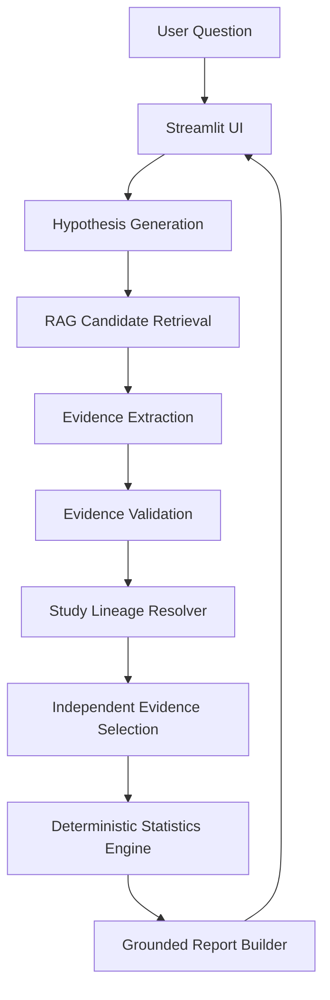

# 🧪 AI-Assisted Drug Safety Evidence Analysis

> **Evidence-grounded analysis of drug safety questions using LLM-assisted retrieval and extraction with deterministic 2×2 statistics and study-lineage protection.**

---

## 🧒 The Project in One Sentence

Imagine you ask a question about whether a medicine might cause a side effect. Our computer looks through research papers, finds the exact tables with numbers, checks that the study information is correct, makes sure not to count the same study twice, does the math using standard Python formulas, and shows you the answer with the exact sentence from the original research paper.

---

## 🎯 What Problem Are We Solving?

When medical researchers evaluate drug safety, important evidence is scattered across hundreds of multi-page PDF documents. 

- **Finding Information is Hard**: Searching manually through dozens of clinical trials takes days.
- **AI Math is Unreliable**: Normal AI chatbots (LLMs) often make mistakes when doing math or reading numerical tables.
- **Double Counting Risk**: Multiple paper reports often re-analyze the exact same patient group. Counting them as separate independent studies leads to wrong statistical conclusions.

### ⚠️ Important Disclaimer & Boundary
This project is an **educational research and decision-support prototype**.  
It is **NOT**:
- A doctor or medical diagnostic tool
- A clinical decision system
- A regulatory approval framework
- A production pharmacovigilance platform

It does not determine whether a drug is clinically safe or unsafe.

---

## 🧒 How Does It Work? — The Story

```
 👦 1. You Ask a Question
        │
        ▼
 🧠 2. The AI Understands the Question
        │
        ▼
 📚 3. The Computer Searches Research Papers (RAG)
        │
        ▼
 📑 4. The AI Extracts Numbers & Exact Quotes
        │
        ▼
 🛡️ 5. Python Validates the Numbers
        │
        ▼
 🌳 6. The System Checks Study Lineage (No Double Counting)
        │
        ▼
 🧮 7. Python Calculates Statistics (Math)
        │
        ▼
 📊 8. The System Shows the Result & Evidence
```

1. **👦 Step 1 — You Ask a Question**: You type a question like *"Does empagliflozin increase the risk of genital infection compared with placebo?"*
2. **🧠 Step 2 — The AI Understands the Question**: The system breaks your sentence into key parts: the **drug** (*empagliflozin*), **comparator** (*placebo*), and **outcome** (*genital infection*).
3. **📚 Step 3 — The Computer Searches Research Papers (RAG)**: The computer searches through stored PDF pages to find the exact pages mentioning these words.
4. **📑 Step 4 — The AI Extracts Numbers & Exact Quotes**: The AI reads the table on those pages and pulls out the patient numbers and exact sentences.
5. **🛡️ Step 5 — Python Validates the Numbers**: Standard Python code checks that the numbers make sense (for example, verifying that event counts cannot be bigger than the total number of patients).
6. **🌳 Step 6 — The System Checks Study Lineage (Overlap Protection)**: The system checks if two papers analyzed the same group of patients, keeping only the primary main trial so numbers aren't counted twice.
7. **🧮 Step 7 — Python Calculates Statistics (Math)**: Python (not the AI!) does the math to calculate the Risk Ratio, Odds Ratio, and $p$-values.
8. **📊 Step 8 — The System Shows the Answer**: The screen displays the final statistics, forest plot, and exact quote from the research paper.

---

## 🏗️ Architecture



### Component Breakdown
- **Streamlit UI (`app/`)**: The web screen you see. Shows metrics and buttons. *Does 0 math.*
- **Hypothesis Engine (`llm/hypothesis.py`)**: Converts questions into structured Pydantic objects.
- **RAG Retriever (`rag/`)**: Finds candidate text chunks using vector embeddings.
- **Evidence Extractor (`llm/extraction.py`)**: Extracts numbers ($a, b, c, d$) and quotes into JSON schemas.
- **Validator (`validation/`)**: Checks numeric bounds and blocks invalid metric types.
- **Study Lineage Resolver (`analysis/`)**: Resolves study overlap and excludes duplicate pooled papers.
- **Statistics Engine (`statistics/`)**: Executes 100% deterministic Python math ($RR$, $OR$, Fisher exact, $\chi^2$).
- **Report Builder (`report/`)**: Builds grounded narrative explanations attached to citations.

---

## 🤖 What Is an LLM?

**Simple Analogy**: An LLM (Large Language Model) is like a smart reading assistant who has read millions of books and can write fluently.

**Technical Name**: Autoregressive Transformer-based Large Language Model.

### ⚠️ Crucial Architectural Rule
**The LLM is NEVER trusted to calculate statistics or do math.**  
In this project, the LLM is used **only** for:
- Understanding natural language questions
- Extracting structured JSON data from tables
- Writing clear narrative summaries

All mathematical formulas and statistical hypothesis tests are calculated by **deterministic Python code**.

---

## 📚 What Is RAG?

**Simple Analogy**: Imagine asking a librarian a question. Instead of guessing an answer from memory, the librarian goes to the bookshelf, pulls out the exact right page, and reads it to you.

**Technical Name**: Retrieval-Augmented Generation (RAG).

### RAG Steps:
1. **Documents**: Original PDF research papers (`EMP-001.pdf` through `EMP-005.pdf`).
2. **Chunks**: Dividing papers into 500-token sections.
3. **Embeddings**: Turning text into numerical fingerprint vectors.
4. **FAISS Vector Store**: A super-fast database searching numerical fingerprints.
5. **Retrieval & Reranking**: Finding the top 25 candidate chunks relevant to the outcome.

---

## ✂️ What Is Chunking?

**Simple Analogy**: Reading a 50-page book to answer a 1-sentence question takes too long. So we cut the book into smaller 1-page snippets called **chunks**.

In this project, papers are divided into ~500-token chunks with page-range metadata attached.

---

## 🔢 What Are Embeddings?

**Simple Analogy**: Imagine giving every sentence a special 384-number code based on its meaning. Sentences with similar meanings get similar number codes.

**Technical Name**: Dense Vector Embeddings.
- **Model Used**: `sentence-transformers/all-MiniLM-L6-v2`
- **Vector Dimensions**: 384 dimensions
- **Search Metric**: Cosine similarity

---

## 🗄️ What Is FAISS?

**Simple Analogy**: FAISS is like an index at the back of a huge book that helps the computer find matching number codes in milliseconds.

**Technical Name**: Facebook AI Similarity Search (FAISS) vector index.

---

## 🧠 What Happens to the User's Question?

Let's follow an example question:  
`"Does empagliflozin increase the risk of genital infection compared with placebo?"`

1. **Question** → Input into Streamlit UI.
2. **Hypothesis** → Drug: *empagliflozin*, Comparator: *placebo*, Outcome: *genital infection*.
3. **Retrieval** → FAISS retrieves 25 candidate chunks from `EMP-001.pdf` – `EMP-005.pdf`.
4. **Extraction** → Reads chunk `EMP-005_CHK_006` and extracts: Treatment events `301 / 4687`, Control events `42 / 2333`.
5. **Validation** → Verifies $301 \le 4687$ and $42 \le 2333$.
6. **Lineage** → Identifies `EMP-005` as the primary trial and excludes overlapping `EMP-001`.
7. **Statistics** → Python calculates Risk Ratio ($3.57$) and Odds Ratio ($3.74$).
8. **Report** → Synthesizes a grounded report with citations.

---

## 🧾 Evidence Extraction

The system extracts structured quantitative records into Pydantic models:

| Field | Example Value | Description |
| :--- | :--- | :--- |
| **Study ID** | `EMP-005` | Name of the clinical trial |
| **Drug** | `empagliflozin` | Treatment drug evaluated |
| **Comparator** | `placebo` | Control arm drug/placebo |
| **Treatment Events / N** | `301 / 4687` | Adverse events / total in treatment arm |
| **Control Events / N** | `42 / 2333` | Adverse events / total in control arm |
| **Metric Type** | `event_count` | Type of quantitative evidence |
| **Source File** | `EMP-005.pdf` | PDF publication file name |
| **Page Range** | `8-10` | Exact page numbers in PDF |
| **Evidence Quote** | *"genital infection 42 (1.8) 153 (6.5)..."* | Verbatim exact text quote from source |

---

## 🛡️ Why Do We Need Validation?

**Simple Analogy**: If a form says 500 people got sick in a room of 100 people, you know someone made a typing mistake.

Our validator (`validation/evidence_validator.py`) checks:
- $N$ must be greater than 0
- Event counts cannot be negative
- Event counts cannot exceed total group sample size ($events \le N$)
- Metric type must be `event_count` (rejects Hazard Ratios, incidence rates, and percentages from 2×2 math)

---

## 🌳 What Is Study Lineage?

**Simple Analogy**: Imagine three children telling you the exact same story they heard from one teacher. If you count it as three independent witness stories, you are making a mistake!

In medical research, post-hoc pooled publications (like `EMP-001` or `EMP-003`) analyze the exact same patients from the primary trial (`EMP-005` / EMPA-REG OUTCOME). Counting both in a meta-analysis double-counts patients.

### Selection Hierarchy:
```
Primary RCT (e.g. EMP-005)
   └── Direct Primary Quantitative Evidence (RETAINED)
         └── Pooled Analyses (EMP-001, EMP-003) (EXCLUDED DUE TO OVERLAP)
               └── Systematic Reviews (EMP-002, EMP-004) (CONTEXT ONLY)
```
*Note: This hierarchy is used strictly for overlap protection and evidence selection in this prototype, not as a universal scientific ranking of literature quality.*

---

## 🧮 How Does the Statistics Work?

All statistical tests are executed in pure Python (`statistics/`):

- **Risk Ratio (RR)**: Measures relative risk ($p_1 / p_2$).  
  $$\text{RR} = \frac{\text{Treatment Events} / \text{Treatment } N}{\text{Control Events} / \text{Control } N}$$
- **Odds Ratio (OR)**: Measures odds of event ($\frac{a/b}{c/d}$).
- **95% Confidence Intervals**: Standard log-normal approximation (Katz et al.) with **Haldane-Anscombe continuity correction** (+0.5 added to cells if any cell is 0).
- **Fisher's Exact Test**: Hypergeometric distribution calculation for exact $p$-values.
- **Pearson's Chi-Square Test**: Asymptotic $\chi^2$ test with 1 degree of freedom.

---

## 🎯 Our Golden Example

- **Question**: *"Does empagliflozin increase the risk of genital infection compared with placebo?"*
- **Primary Study**: `EMP-005` (EMPA-REG OUTCOME Table 2)
- **Empagliflozin (Pooled 10mg + 25mg)**: `301` events / `4687` patients ($6.4\%$)
- **Placebo**: `42` events / `2333` patients ($1.8\%$)
- **Risk Ratio (RR)**: **3.5673** (95% CI: `2.5930 – 4.9077`)
- **Odds Ratio (OR)**: **3.7435** (95% CI: `2.7000 – 5.1902`)
- **Fisher Exact $p$-value**: $7.72 \times 10^{-20}$ ($p < 0.0001$)
- **Chi-Square $p$-value**: $2.64 \times 10^{-17}$ ($p < 0.0001$)

*Meaning in simple terms*: Patients taking empagliflozin had approximately 3.57 times higher risk of genital infection compared to placebo in this trial.

---

## 🚨 What Happens When the System Does NOT Have the Right Data?

The system is designed to **fail safely** rather than fabricate evidence:

1. **Example 1 — No Evidence**: If you ask *"Does empagliflozin cause pulmonary fibrosis?"*, retrieval finds 0 quantitative event chunks. The system skips statistics and displays: *"No independent evidence supporting this question was found in the current curated corpus."*
2. **Example 2 — Hazard Ratio (HR)**: If evidence reports a Hazard Ratio ($HR=0.86$), the validator preserves the text quote but blocks the 2×2 engine, displaying: *"Survival-analysis statistics are not currently implemented in this MVP. The evidence is preserved but is not converted into 2×2 event counts."*
3. **Example 3 — Multi-Arm Study**: Uses reported pooled treatment arm ($301 / 4687$) without fabricating combined denominators.

---

## 📊 Evaluation & Metrics

Our benchmark suite (`evaluation/end_to_end_cases.json`) evaluates system performance:

- **Curated Corpus**: 5 PDF documents (`EMP-001.pdf` – `EMP-005.pdf`), 55 total chunks.
- **Candidate Reachability**: **100%** (target chunks reach top-25 candidate pool).
- **Average Precision@5 ($AP@5$)**: **0.80** across initial retrieval audits.
- **End-to-End Evaluation Pass Rate**: **11 / 11 cases passed (100.0%)**.
- **Full Project Regression Test Suite**: **167 / 167 tests passed (100.0%)**.

*Evaluation Note: Retrieval metrics evaluated across different historical benchmark artifacts reflect specific candidate-pool definitions and should not be combined as a single metric.*

---

## 🧪 Testing

We maintain 167 automated unit and integration tests covering:
- **Unit Behavior**: Individual formulas, validators, and formatters.
- **Integration Behavior**: RAG retrieval, lineage resolution, and pipeline execution.
- **Negative / Safety Cases**: No-evidence questions, Hazard Ratio blocking, and overlap exclusion.

---

## 📁 Project Structure

```
drug-safety-ai/
│
├── app/          → Streamlit web UI screen (app/streamlit_app.py) & UI unit tests
├── analysis/     → Study lineage resolver, overlap protector, & comparative normalizer
├── data/         → Raw PDF publications, processed text chunks, FAISS vector index, & metadata
├── docs/         → Quality gate scorecard, technical defense guide, & demo scripts
├── evaluation/   → 11-case end-to-end benchmark dataset & runner
├── ingestion/    → PDF page loader, text chunker, & metadata extractors
├── llm/          → LLM hypothesis generator, structured JSON extractors, & report builder
├── pipeline/     → 10-stage end-to-end pipeline orchestrator (pipeline.py)
├── rag/          → Dense vector embeddings, FAISS indexer, & outcome-aware retriever
├── report/       → Grounded report builder & citation formatter
├── statistics/   → Deterministic Risk Ratio, Odds Ratio, & Hypothesis Test engines
├── validation/   → Numerical bounds validator & metric-type filter
├── .env.example  → Environment variable configuration template
├── .gitignore    → Git exclusion rules
├── README.md     → Project documentation and quickstart guide
└── requirements.txt → Python package dependencies
```

---

## 🗺️ Development Journey — EVERY TASK

| Task | What We Built (Simple Analogy) | Technical Implementation |
| :--- | :--- | :--- |
| **Task 5** | **Reading Books**: Turning PDF pages into clean computer text. | PyMuPDF PDF loader, 500-token text chunker with page metadata. |
| **Task 6** | **Fingerprinting**: Creating numerical fingerprints for text search. | SentenceTransformers `all-MiniLM-L6-v2` 384d FAISS indexer. |
| **Task 6.1** | **Checking Search Quality**: Testing if search finds the right pages. | Precision@K retrieval quality audit scripts. |
| **Task 7** | **Understanding Questions**: Breaking user questions into key parts. | Structured hypothesis generator using Pydantic schema parsing. |
| **Task 8** | **Extracting Numbers**: Pulling numbers out of tables and checking them. | LLM structured JSON table extractor & `evidence_validator.py`. |
| **Task 9** | **Doing Math**: Calculating Risk Ratio, Odds Ratio, and $p$-values in Python. | Deterministic `risk_ratio.py`, `odds_ratio.py`, & `hypothesis_test.py`. |
| **Task 10** | **Comparing Studies**: Putting statistics from different papers side-by-side. | `study_comparison.py` multi-study evidence normalizer. |
| **Task 11** | **Writing Reports**: Generating grounded text reports attached to quotes. | `report_builder.py` grounded citation report builder. |
| **Task 12** | **Connecting Everything**: Building the complete 10-stage analysis pipeline. | `pipeline.py` orchestrator linking all stages. |
| **Task 13** | **Generalization Testing**: Verifying pipeline handles different questions. | Multi-query generalization test suite. |
| **Task 14–16** | **Tree of Studies**: Checking if papers overlap to prevent double counting. | `study_lineage.py`, `lineage_resolver.py`, & `evidence_selection.py`. |
| **Task 17–18** | **Pipeline Polish**: Ensuring statistics boundary and selection stay strict. | Artifact consistency audits & strict statistical boundary tests. |
| **Task 19–19A** | **Search Optimization**: Improving retrieval so target tables reach candidate pool. | Outcome-aware semantic keyword re-ranking in `retriever.py`. |
| **Task 20** | **Live Primary Evidence**: Proving live path with real EMP-005 evidence. | End-to-end live pipeline run with real corpus data. |
| **Task 21–22** | **Benchmark Suite**: Creating 11-case benchmark & non-2×2 semantics. | `end_to_end_cases.json` & non-2×2 safe skip semantics. |
| **Task 23** | **Reproducible Summary**: Creating automated summary reports of metrics. | `evaluation_summary.json` & `evaluation_summary.md`. |
| **Task 24** | **Building UI Screen**: Creating the first Streamlit web interface. | `app/streamlit_app.py` Streamlit MVP presentation layer. |
| **Task 25** | **Polishing UI**: Adding Forest plot, metric cards, and clean sections. | SVG Forest plot renderer, metric cards, & 10 UI helper tests. |
| **Task 26** | **Demo Walkthrough**: Testing all demo steps and verifying numbers. | Golden Path verification & `docs/DEMO_SCRIPT.md`. |
| **Task 27** | **Quality Audit**: Reviewing complete architecture and test suite. | `docs/PROJECT_QUALITY_GATE.md` technical audit scorecard. |
| **Task 28** | **Interview Prep**: Creating presentation deck and defense guide. | `FINAL_PRESENTATION_OUTLINE.md`, `INTERVIEW_DEFENSE.md`, & pitches. |

---

## 🧰 Technology Used

| Technology | What It Does | Why We Use It |
| :--- | :--- | :--- |
| **Python 3.10+** | Core programming language | Industry standard for AI, ML, and data processing. |
| **Streamlit** | Web application framework | Fast, beautiful UI presentation layer. |
| **SentenceTransformers** | Generates text embeddings | Converts text into 384-dimensional semantic vectors. |
| **FAISS** | Vector database search engine | Ultra-fast similarity search over embedding vectors. |
| **Pydantic** | Data validation & schema definition | Guarantees strict JSON schema structure for LLM outputs. |
| **PyMuPDF (fitz)** | PDF document parser | Extracts clean text and page numbers from PDF files. |
| **Unittest** | Automated testing framework | Runs 167 unit, integration, and regression tests. |

---

## 🔐 Security & Configuration
- **`.env` Ignored**: Local environment files are excluded by `.gitignore`.
- **`.env.example` Provided**: Clean template provided for environment setup.
- **No Hardcoded Secrets**: API keys and local endpoint URLs are environment-driven.

---

## ⚠️ System Limitations
- **Corpus Size**: Curated 5 empagliflozin publications (`EMP-001` through `EMP-005`).
- **Survival Analysis**: Hazard Ratio metrics are preserved but not converted into 2×2 event counts.
- **Tabular Extraction**: Complex multi-row tables rely on LLM structured JSON output mode when live.
- **Prototype Scope**: Designed as a research decision-support tool; **not a production medical system**.

---

## 🚀 How to Run the Project

### 1. Clone & Set Up Virtual Environment
```bash
git clone https://github.com/ayushkumar29/drug-safety-AI.git
cd drug-safety-AI
python -m venv venv

# On Windows:
venv\Scripts\activate
# On Linux/Mac:
source venv/bin/activate
```

### 2. Install Dependencies
```bash
pip install -r requirements.txt
```

### 3. Environment Setup
Create `.env` based on `.env.example`:
```env
LLM_PROVIDER=offline
LLM_MODEL=google/gemma-4-e4b
LLM_BASE_URL=http://localhost:1234/v1
LLM_API_KEY=lm-studio
```

### 4. Run Automated Tests
```bash
python -m unittest discover -s . -p "test_*.py"
```

### 5. Launch Streamlit UI
```bash
streamlit run app/streamlit_app.py
```
Open browser to `http://localhost:8501`.

---

## 🧪 How to Run Tests

Run the full automated unittest suite:
```bash
python -m unittest discover -s . -p "test_*.py"
```
This executes all 167 unit, integration, and regression tests.

---

## 🎬 Live Demo & Interview Prep

- 🎬 **Live Demo Sequence**: See [`docs/DEMO_CHECKLIST.md`](docs/DEMO_CHECKLIST.md)
- 📊 **Presentation Deck**: See [`docs/FINAL_PRESENTATION_OUTLINE.md`](docs/FINAL_PRESENTATION_OUTLINE.md)
- ⏱️ **60-Second Pitch**: See [`docs/PROJECT_ONE_MINUTE_PITCH.md`](docs/PROJECT_ONE_MINUTE_PITCH.md)
- 🛡️ **Technical Defense Q&A**: See [`docs/INTERVIEW_DEFENSE.md`](docs/INTERVIEW_DEFENSE.md)

---

## 🧭 Future Improvements
- Expand vector index to full open-access PubMed/PMC biomedical literature.
- Implement Cox proportional hazards survival models for Hazard Ratio evidence.
- Build a gold-standard human-annotated extraction benchmark dataset.

---

## ⚖️ Important Disclaimer
*This repository is an educational research and decision-support prototype. It does not provide medical advice, clinical diagnosis, or regulatory safety determinations, and is not a substitute for clinical judgment.*
